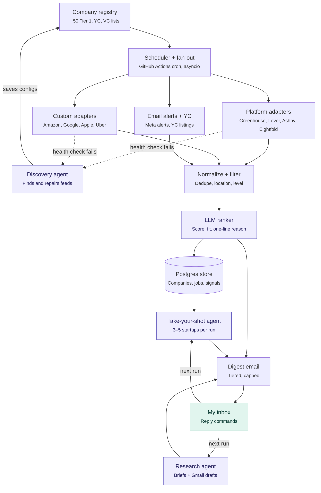
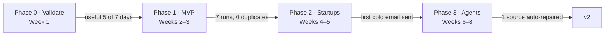

# Job Finding Agent

A twice-daily agent that crawls careers pages at Tier 1 companies and top startups, ranks new roles against my CV, and emails one digest with direct apply links and cold-email drafts ready to review.

**Status:** Phase 0 · Validate (design done, build not started)

| Doc | What's in it |
| --- | --- |
| [High-level design](docs/HLD.md) | Goals, architecture, tiers, adapters, agents, data model, stack, milestones |
| [TODO](TODO.md) | Every task by phase, with the gate that ends each phase |

## Architecture

A deterministic pipeline, with LLM agents (purple) only where the next step can't be known in advance.

## Three tiers

| Tier | Companies | Locations |
| --- | --- | --- |
| Tier 1 | ~50 hand-picked (FAANG+, big tech, infra, fintech, AI labs, Indian top product) | India + Europe hubs |
| Tier 1 Startups | YC + top VC portfolios, tracked even with no openings (cold outreach) | Anywhere |
| Other | Fortune 500 India engineering centres + remaining startups | India |

## Stack

Python 3.12 · httpx · Pydantic · Playwright · PostgreSQL (Neon free tier) · OpenAI API · Gmail API · GitHub Actions (cron). Hosting cost: $0.

## Milestones

## License

See [LICENSE](LICENSE).
