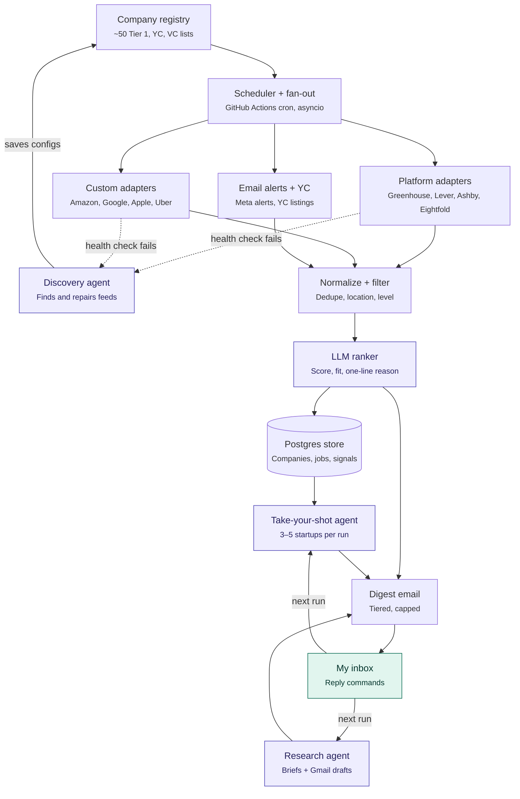
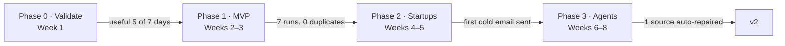

# Job Finding Agent

A twice-daily agent that crawls careers pages at Tier 1 companies and top startups, ranks new roles against my CV, and emails one digest with direct apply links and cold-email drafts ready to review.

**Status:** Phase 0 · Validate (design done, build not started)

| Doc | What's in it |
| --- | --- |
| [High-level design](docs/HLD.md) | Goals, architecture, tiers, adapters, agents, data model, stack, milestones |
| [TODO](TODO.md) | Every task by phase, with the gate that ends each phase |

## Architecture

A deterministic pipeline, with LLM agents (purple) only where the next step can't be known in advance.

## Three tiers

| Tier | Companies | Locations |
| --- | --- | --- |
| Tier 1 | ~50 hand-picked (FAANG+, big tech, infra, fintech, AI labs, Indian top product) | India + Europe hubs |
| Tier 1 Startups | YC + top VC portfolios, tracked even with no openings (cold outreach) | Anywhere |
| Other | Fortune 500 India engineering centres + remaining startups | India |

## Stack

Python 3.12 · httpx · Pydantic · Playwright · PostgreSQL (Neon free tier) · OpenAI API · Gmail API · GitHub Actions (cron). Hosting cost: $0.

## Milestones

## Gmail setup (digest sending)

The digest is sent **from a dedicated bot Gmail account** to your personal address (`DIGEST_TO`).
The bot's token has two scopes only: `gmail.send` and `gmail.readonly` (used to check, after an
interrupted run, whether a digest already went out, so nothing is ever sent twice).

1. **Create the bot account**: a new Gmail address used only for sending the digest.
2. **Google Cloud project**: at console.cloud.google.com, create a project (signed in as the bot),
   then *APIs & Services → Library → Gmail API → Enable*.
3. **OAuth consent screen**: *APIs & Services → OAuth consent screen*. User type **External**;
   app name e.g. "job digest"; your bot address as support and developer contact. Add the scopes
   `.../auth/gmail.send` and `.../auth/gmail.readonly`. Add the bot address under *Test users*.
   Then **Publish app** (status "In production"): while an app stays in "Testing", Google expires
   its refresh tokens after 7 days. Unverified is fine for your own account; you see a warning once.
4. **OAuth client**: *APIs & Services → Credentials → Create credentials → OAuth client ID*,
   application type **Desktop app**. Copy the client ID and secret into `.env` as
   `GMAIL_CLIENT_ID` and `GMAIL_CLIENT_SECRET`.
5. **Authorise once** (in your own terminal; the token is a secret):
   `uv run python scripts/gmail_auth.py --write-env`. Sign in **as the bot account**. The script
   writes `GMAIL_REFRESH_TOKEN` into `.env` without printing it.
6. **Recipient**: set `DIGEST_TO=` (your personal address) in `.env`.
7. **Check**: `uv run python -m jobagent.jobs.run --dry-run` writes `out/digest.html` without
   sending; `uv run python -m jobagent.jobs.run` sends.

For GitHub Actions, add the same four values (`GMAIL_CLIENT_ID`, `GMAIL_CLIENT_SECRET`,
`GMAIL_REFRESH_TOKEN`, `DIGEST_TO`) as repository secrets.

## Running it (GitHub Actions)

Three workflows in `.github/workflows/`:

| Workflow | When | What |
| --- | --- | --- |
| `run.yml` | 08:00 and 18:00 IST, or by hand | migrate the DB, then crawl, filter, rank and email the digest |
| `ci.yml` | every push to `main` and every pull request | ruff, pyright, pytest (database tests skip) |
| `keepalive.yml` | weekly | re-enables the scheduled workflows so GitHub does not pause them after 60 days |

**Secrets** (*Settings → Secrets and variables → Actions → Secrets*):
`DATABASE_URL`, `OPENAI_API_KEY`, `CV_BLOB_SAS_URL`, `GMAIL_CLIENT_ID`, `GMAIL_CLIENT_SECRET`,
`GMAIL_REFRESH_TOKEN`, `DIGEST_TO`; optional: `PROFILE_OVERRIDES_SAS_URL`, `HEALTHCHECK_URL`.

**Variables** (same page, *Variables* tab; not secret): `RANK_MODEL`, `PROFILE_MODEL`; optional:
`RANK_TOKEN_BUDGET`; and `JOBAGENT_ENABLED`.

**Switching it on.** Scheduled runs do nothing until the variable `JOBAGENT_ENABLED` is `true`.
Set it only after the first digest has been checked by hand (see "Gmail setup"): the first send
emails the whole backlog.

**Running by hand.** *Actions → run → Run workflow*, then pick `mode`:
- `dry-run` (the default): the full pipeline with counts only; nothing is sent or marked as emailed;
- `send`: the same as a scheduled run.

**What the logs show.** Counts only: jobs per source, filter reasons, ranking tokens and cost, and
digest line counts. Never titles, reasons, your profile, addresses or URLs. `CI=true` hides the
top-10 list, GitHub masks secret values, and `out/digest.html` is never uploaded.

**When something fails.** A failed send, ranking error or crash fails the workflow, and GitHub emails
you (*Settings → Notifications → Actions*). A failed send is retried by the next run without
duplicates. Tokens that expire: `CV_BLOB_SAS_URL` (the run warns 14 days ahead; generate a new SAS
URL) and `GMAIL_REFRESH_TOKEN` (if revoked, run `scripts/gmail_auth.py` again).

**Dead-man's switch (optional).** Catches what failure emails cannot: a schedule that stopped, or a
run that never started.
1. At healthchecks.io (free plan), create a check. Set **Period 1 day** and **Grace 2 hours**:
   no ping for 26 h, and it emails you.
2. Copy its ping URL into the secret `HEALTHCHECK_URL`.
3. Every successful *sending* run pings it at the very end (dry runs do not, so a dry run can
   never hide stopped sends). A failed ping never fails the run.

## License

See [LICENSE](LICENSE).
