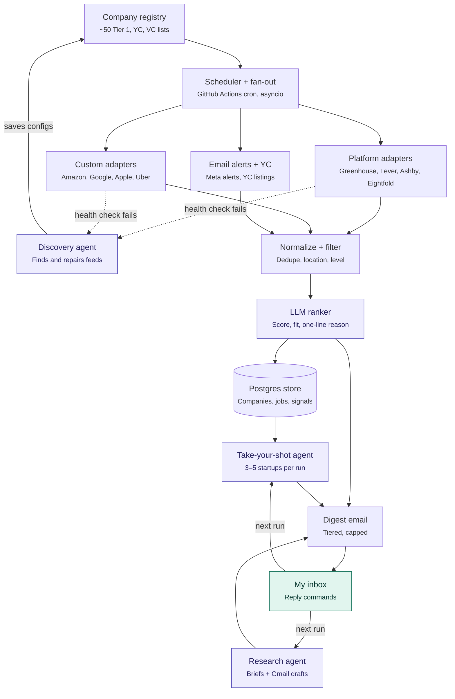
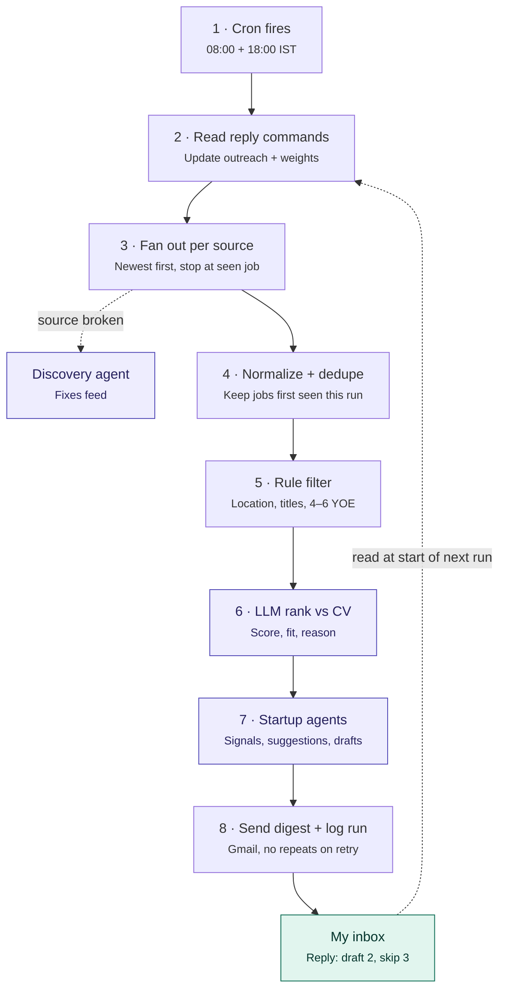
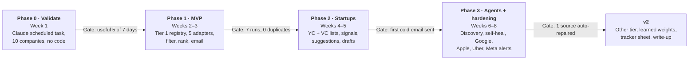

# Job Hunter Agent — High-Level Design

**Version:** 0.3 · **Updated:** 6 Nov 2026 · **Status:** Phase 0 (Validate)
Progress lives in [TODO.md](../TODO.md).

---

## 1. Problem and goals

A twice-daily system that finds new roles and startup targets that match my profile, ranks them, and emails one actionable digest with direct links and cold-email drafts ready to review.

**Goals for v1**

- Every new matching role at ~50 Tier 1 companies (India and Europe) reaches my inbox within 12 hours of posting
- A ranked list of Tier 1 startups (YC plus top SF/NYC), with or without openings, each with a reason and an outreach angle
- 3–5 "Take your shot" company suggestions per day that improve from my replies
- $0 hosting (free tiers only), LLM spend of a few cents per run; a digest I can act on in 10 minutes

**Non-goals for v1:** auto-applying, auto-sending email, scraping LinkedIn or Naukri, anything behind a login, a web UI (the email and a tracker sheet are the UI).

---

## 2. Requirements

**Functional**

1. Crawl jobs from all registered companies at 08:00 and 18:00 IST (Other tier once a day)
2. Keep only jobs first seen in this run that pass the tier's location, title and experience rules
3. Score each surviving job against my CV (score 0–100, fit label, one-line reason)
4. Track Tier 1 startups as companies, with or without openings, and detect fresh signals (funding, new batch, launch, first engineering post)
5. Draft cold emails into Gmail for review; never send
6. Send one digest email per run, grouped by tier, with a "Take your shot" section
7. Learn from my actions (draft, skip, snooze, reply)

**Non-functional**

| Property | Target |
| --- | --- |
| Run time | Under 10 minutes per run |
| Freshness | New role reaches inbox within 12 h of posting |
| Cost | $0 hosting; LLM only, a few cents per run |
| Isolation | One broken source never blocks the run |
| Idempotency | A retried run never re-sends a job or a draft |
| Explainability | Every suggestion shows why it was picked |

**Scale (rough, to validate in MVP)**

| Tier | Companies | Requests per run | New jobs per run |
| --- | --- | --- | --- |
| Tier 1 | ~50 | ~100 (1–2 each, stop at first seen job) | 10–40 |
| Tier 1 Startups | 500–1,500 tracked | ~1,500 (one per job board) | 20–60 |
| Other | 200–500 | ~500, once a day | 20–50 |

LLM calls per run: about 50–150 after rule filters, plus 3–5 research briefs.

---

## 3. Architecture

A deterministic pipeline, with LLM agents only at three decision points (purple).



### One run, end to end



---

## 4. Company registry and tiers

Tier is a property of the company, set once in the registry by me; the crawler and the LLM never change it. Tier means brand and pay bar, not size or funding stage, so Stripe and Databricks are Tier 1.

Precedence when lists overlap: **Tier 1 list → Tier 1 Startup list → Other.**

| Tier | Source of companies | Unit in digest | Locations | Visa rule | Cadence |
| --- | --- | --- | --- | --- | --- |
| Tier 1 | Hand-curated list of ~50 (FAANG+, big tech, infra, fintech, security, AI labs, Indian top product) | Jobs | India + Europe hubs: Dublin, London, Amsterdam, Berlin, Zurich, Warsaw, Stockholm, Copenhagen | Label only | 2x/day |
| Tier 1 Startups | YC directory (hiring, recent batches, 10–500 people, active) + top VC portfolios (a16z, Sequoia, Benchmark, Founders Fund, Accel, Lightspeed) | Companies, with jobs attached | Anywhere | No filter; label only | 2x/day |
| Other | Fortune 500 with India engineering centres + remaining discovered startups | Jobs | India | n/a | 1x/day |

- **Title keywords (all tiers):** SDE2, Senior, Backend, Platform, Distributed Systems, AI Engineer
- **Experience:** roles asking 4+ years are the target; Tier 1 roles asking more than 6 are dropped
- **Startups:** founding-engineer roles included; contract and contract-to-hire roles excluded
- Companies with large US engineering offices carry `us_transfer_path = true` and rank slightly higher (L-1 transfer route after a year)
- New companies found by the agent get a suggested tier and sit in an **Unreviewed** bucket until I confirm

---

## 5. Fetch layer

Adapters are written per hiring **platform**, not per company, so one adapter plus a config covers every company on that platform; only fully in-house careers sites get their own adapter.

```python
class JobSource(Protocol):
    async def search(self, spec: SearchSpec, stop_at_job_id: str | None) -> AsyncIterator[RawJob]: ...
    async def get_details(self, job_id: str) -> JobDetail: ...
    async def health_check(self) -> HealthReport: ...   # ok, job_count, schema_hash
```

| Source kind | Covers | How it fetches | Risk |
| --- | --- | --- | --- |
| Platform adapters | Greenhouse, Lever, Ashby, Eightfold (Microsoft, Netflix), Workday | Public or page-backing JSON endpoints | Low |
| Custom adapters | Amazon (public search JSON), Google (JSON embedded in results page), Apple, Uber | Endpoint found once by network capture | Medium: undocumented, breaks every few months |
| Email-alert sources | Meta and any site that blocks automation | Subscribe to the company's own job alerts; parse them from Gmail | Low, and compliant |
| YC listings | YC job pages and company job pages | Public listing pages with structured salary, experience and visa fields | Low |
| Directory feeds | YC directory (Algolia index; key read fresh each run), VC portfolio pages | Company discovery only, no jobs | Low |

Reference endpoints:

- Greenhouse: `https://boards-api.greenhouse.io/v1/boards/{token}/jobs`
- Lever: `https://api.lever.co/v0/postings/{company}?mode=json`
- Ashby: `https://api.ashbyhq.com/posting-api/job-board/{board}?includeCompensation=true`
- Amazon: `https://www.amazon.jobs/en/search.json` (max 10,000 results per search → split by category)
- Microsoft (Eightfold): `https://apply.careers.microsoft.com/api/pcsx/search?domain=microsoft.com&query=…&location=India` + `/api/pcsx/position_details` (the older `/api/apply/v2/jobs` returns 403)

**Incremental crawl.** Every query is scoped (location, engineering category, newest first). Paging stops at the first job ID already in the store, so most runs cost 1–2 requests per company. Full descriptions are fetched only for new jobs that passed the rule filters.

**Politeness.** Per-domain rate limit with a delay between requests, robots.txt respected, no logins, read-only.

---

## 6. Agents

Agency is used only where the next step cannot be known in advance; everything else is a deterministic pipeline that calls agents at three points.

| Agent | Trigger | Goal | Tools | Output | Limits |
| --- | --- | --- | --- | --- | --- |
| Source discovery and self-heal | New company added, or a health check fails (job count drops to 0, 403, schema change) | Return a working feed config, or say why it is impossible | `web_search`, `fetch_url`, `detect_ats`, `try_ats_endpoint`, `render_page`, `capture_network_requests`, `validate_feed` | A source config saved to the registry; future runs use the cheap adapter | 15 steps, read-only, no logins; config goes live only after `validate_feed` passes |
| Startup research and outreach | I reply "draft N", or a High-fit startup has a fresh signal | Give me what I need to act today | `fetch_job_page`, `web_search`, `read_company_pages`, `draft_email` | A short brief + a Gmail draft | 10 steps; public contact routes only; never sends; one follow-up after 7 days |
| Take-your-shot suggester | Every run | Pick 3–5 startups worth a cold email today | Registry queries, signal store, preference weights | A ranked list with reason, angle and contact | Max 2 per niche; 60-day cool-off after skip or contact |

**Suggestion score** = problem-space fit (high) + fresh signal in last ~30 days (high) + stage fit, seed to Series B with 10–150 people (medium) + remote or India openness (medium), adjusted by learned preference weights.

**Learning loop.** "draft" = strong positive; "skip N reason" down-weights that reason (stack, domain, stage, location); a reply from a founder is the strongest signal. Weights are plain, editable values, never a black box.

---

## 7. Processing

Cheap deterministic steps run first, so the LLM only sees the 5–10% of jobs that could plausibly fit.

1. **Normalize** every raw job to one schema: source job ID, company, title, location, apply URL, posted date, description hash. Locations map to ISO country codes; vague ones ("Multiple Locations, EMEA") go to an LLM classifier once and are cached.
2. **Dedupe** with an upsert on (company, source job ID), tracking `first_seen` and `last_seen`. Cross-source duplicates (a YC listing and the same role on Ashby) collapse on company + normalized title + country.
3. **Rule filter** per tier: location, title keywords, excluded words (Staff, Principal, Manager, Intern, Contract), Tier 1 experience 4 to 6 years.
4. **LLM rank** only jobs where `first_seen` is this run. Input: job description + my CV (source of truth for skills, projects and experience). Output via OpenAI Structured Outputs: score 0–100, fit (High / Medium / Low), one-line reason. Batched, small model.
5. **Mark stale:** a job missing for 3 consecutive runs is closed.

Links in the digest always come from source data, never from LLM output.

---

## 8. Digest email

One HTML email per run, ordered by how hard each role is to get and how much it matters, with every section capped so Tier 1 is never buried.

| Order | Section | Content | Cap |
| --- | --- | --- | --- |
| 1 | Tier 1 — India | New jobs, High and Medium | None |
| 2 | Tier 1 — Europe | New jobs; star on US-transfer-path companies | Top 10 |
| 3 | Tier 1 Startups — Hot signals | Companies with a fresh trigger; draft ready to review | Top 5 |
| 4 | Tier 1 Startups — Open roles | All regions; visa label on each | Top 15 |
| 5 | Other — India | New jobs, High only | Top 5 |
| 6 | Take your shot | 3–5 suggested startups with reason, angle, contact | 5 |
| 7 | Outreach tracker | Drafts waiting, follow-ups due, replies | n/a |
| 8 | Unreviewed companies | New companies with a suggested tier | n/a |

Each job line: score badge · company · title · location · required experience · days since posted · one-line reason · Apply link.

Subject carries the counts, e.g. "14 new: 3 Tier 1, 6 Startup, 5 Other". No new matches → no email.

**Actions are reply commands**, e.g. `draft 2`, `skip 3 stack`, `snooze 1`, `confirm 4 t1_startup`. The next run reads replies from Gmail, so the learning loop needs no server and hosting stays free.

---

## 9. Data model

Seven tables in one Postgres database; the company row is the hub everything else hangs off.

| Table | Key fields | Notes |
| --- | --- | --- |
| Company | id, name, tier, source_list, india_presence, europe_presence, us_transfer_path, yc_batch, last_round_date, team_size, review_status | Tier set by me; review_status = unreviewed / confirmed |
| Source | id, company_id, kind (platform / custom / email_alert / yc), platform, tenant_config (JSON), health_status, last_ok_at, expected_job_count | One company can have several sources |
| Job | id, company_id, source_id, source_job_id, title, country, city, url, posted_at, min_yoe, visa_label, description_hash, first_seen, last_seen, status | Unique on (company_id, source_job_id) |
| Ranking | job_id, model, score, fit, reason, ranked_at | One row per job per profile version |
| Signal | id, company_id, kind (funding / batch / launch / first_eng_post / blog), occurred_at, url | Drives Hot signals and suggestions |
| Outreach | id, company_id, status (suggested / drafted / sent / followed_up / replied / closed), gmail_draft_id, last_action_at, cool_off_until | One open row per company |
| Run | id, started_at, finished_at, per_source_counts (JSON), emailed_job_ids, cost_usd | Idempotency + observability |

The CV and preference weights stay out of the public repo. The CV lives in a private Azure Blob container (see §10); preference weights live in a private config loaded at run time.

### Why Postgres, not NoSQL

The data is relational and the hot paths are relational operations, so a relational store fits better than a document store here.

| Access pattern | Postgres | Document store (Cosmos DB, MongoDB) |
| --- | --- | --- |
| Dedupe: upsert on (company, source_job_id) | One `INSERT … ON CONFLICT` with a unique constraint | Needs a careful partition key and id design to get the same guarantee |
| Digest: jobs ⋈ rankings ⋈ companies, filtered by tier and score | One SQL query | Several queries joined in code, or duplicated data |
| Outreach state machine with cool-off dates | Constraints and transactions | Possible, more code |
| Flexible bits (adapter configs, raw payload samples) | `JSONB` columns | Native |
| Scale | ~50k–100k job rows, well under 1 GB | Built for far larger scale than this needs |

NoSQL would be the right call only if raw HTML/JSON snapshots were stored at volume; those would go to blob storage, not the database.

---

## 10. Tech stack and hosting

Python, free tiers only, public repo. At this scale one async process per run replaces a queue; failure isolation comes from per-source tasks and a dead-letter table instead of a message broker.

| Concern | Choice | Why |
| --- | --- | --- |
| Scheduler | GitHub Actions cron (`30 2,12 * * *` UTC = 08:00 and 18:00 IST) | Free for public repos; no server |
| Fan-out | `asyncio` tasks, one per source, per-domain semaphores, retry with backoff | Enough for ~2,000 requests per run in one job |
| HTTP | `httpx` (async) | Timeouts, HTTP/2, easy to record for tests |
| Browser | Playwright for Python, only for discovery and JS-only sites | Installed only in the discovery workflow |
| Models | Pydantic | One validated schema for jobs, configs, LLM output |
| Store | Neon Postgres, Free plan, via SQLAlchemy + Alembic | Permanent free plan (1 GB storage, 100 CU-hours/month per project); two ~10-minute runs a day use a few CU-hours; scales to zero between runs |
| CV | PDF in a private Azure Blob container, read with a read-only SAS URL | Update the CV by re-uploading the same blob; the next run picks it up |
| LLM | OpenAI API (existing credits): small model for ranking with Structured Outputs, stronger model for agents | The one paid piece; rule-score fallback; monthly budget cap set in OpenAI |
| Email | Gmail API (send digest, create drafts, read replies) | Drafts land in my own inbox |
| Secrets | GitHub Actions secrets: `OPENAI_API_KEY`, `DATABASE_URL`, `GMAIL_TOKEN`, `CV_BLOB_SAS_URL` | Nothing sensitive committed |
| Tracker | Export of Company + Outreach to a sheet | Full startup list lives outside the email |

**Hosting.** Nothing runs between runs. Each run is a GitHub Actions job: checkout, install dependencies (cached), `python -m jobs.run`, exit. A weekly keep-alive workflow stops GitHub pausing the schedule after 60 days without activity. Actions logs are public, so logs carry counts only, never job data, CV or email content.

**CV loading.** At the start of each run: download the CV with the SAS URL, extract text (`pypdf`), hash it. Only when the hash changes, rebuild the ranking profile (skills, years, projects) with one LLM call and store it, versioned, so rankings record which profile version they used. The SAS is scoped to that one blob, read-only, with an expiry; a run-failure alert fires before it lapses.

**Why Neon over Azure or AWS Postgres.** Azure Database for PostgreSQL (B1MS, 32 GB) and AWS RDS are free only for 12 months for new accounts, then bill for an always-on server. Neon's Free plan does not expire and suspends when idle, which suits a job that runs 20 minutes a day. Moving later is a connection-string change, since it is plain Postgres.

**Planned repo layout**

```
core/        models, contracts, config
adapters/    greenhouse, lever, ashby, eightfold, amazon, google, ...
pipeline/    normalize, dedupe, filter, rank
agents/      discovery, research, suggester
digest/      templates, send, reply-command parser
jobs/        entry points run by GitHub Actions
tests/       adapter contract tests against recorded responses
companies.yaml   the registry seed (tiers set by me)
```

Trade-off accepted: no Azure Service Bus or Functions, so the interview story is the design itself: platform adapters, incremental crawl, self-healing agent, idempotent delivery.

---

## 11. Reliability, observability, cost

The main failure mode is silent: a source quietly returns zero jobs because the site changed, so health checks matter more than retries.

| Risk | Detection | Response |
| --- | --- | --- |
| Source breaks silently | Job count falls below 30% of its 7-day average, or schema hash changes | Mark unhealthy, trigger discovery agent, list it in the digest footer |
| Source errors (403, 429, timeout) | Error rate per source | Backoff retries, then a dead-letter table; run continues |
| Duplicate email on retry | Run table stores emailed job IDs | Skip anything already sent |
| LLM cost spike | Cost per run logged | Hard budget per run; over budget → rank top N by rule score only |
| Bad LLM output | JSON schema validation | Retry once, else fall back to rule score |
| Whole run fails | No Run row by 09:00 / 19:00 IST | Alert email |
| Schedule paused | No run for 24 h | Keep-alive workflow; alert |

**Metrics per run:** jobs fetched, new, filtered, ranked, emailed per source; agent invocations and outcomes; cost in USD.

---

## 12. Compliance and guardrails

- Read only public job data; no logins, no CAPTCHAs, no proxies to evade blocks
- Respect robots.txt and per-domain delays; a site that blocks automation moves to email alerts
- No LinkedIn, Naukri or Work at a Startup scraping
- Never submit applications; never send email; drafts only, one follow-up maximum
- Contacts only from public routes (published email, company careers address, public profile); no guessed emails or SMTP probing
- Daily cap of 5 outreach drafts
- Agents have step limits and budgets; every agent action is logged
- Public repo: no CV, tokens or job data are ever committed

---

## 13. Milestones



Detailed tasks: [TODO.md](../TODO.md).

---

## 14. Decisions log

| Topic | Decision (6 Nov 2026) |
| --- | --- |
| Stack | Python |
| LLM | OpenAI API (existing credits) |
| Hosting | Free tiers only: GitHub Actions + Neon Postgres |
| Database | Postgres (Neon Free plan), not NoSQL: relational data, upserts and joins |
| CV storage | Private Azure Blob container, read via read-only SAS URL |
| Repo | Public on GitHub |
| Roles | SDE2, Senior, Backend, Platform, Distributed Systems, AI Engineer |
| Experience | Roles asking 4+ years; Tier 1 capped at 6 |
| Europe | Dublin, London, Amsterdam, Berlin, Zurich, Warsaw, Stockholm, Copenhagen |
| Startups | Founding engineer yes; contract roles no; no visa filter |
| Profile | CV is the source of truth for ranking |
| Inbox | Same Gmail for digest and drafts |
| Priority | This is the one active project |
